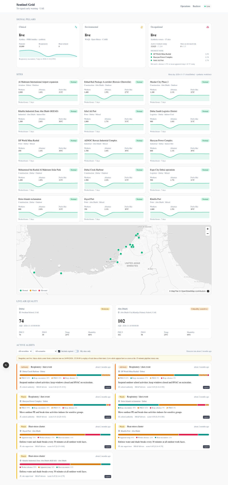
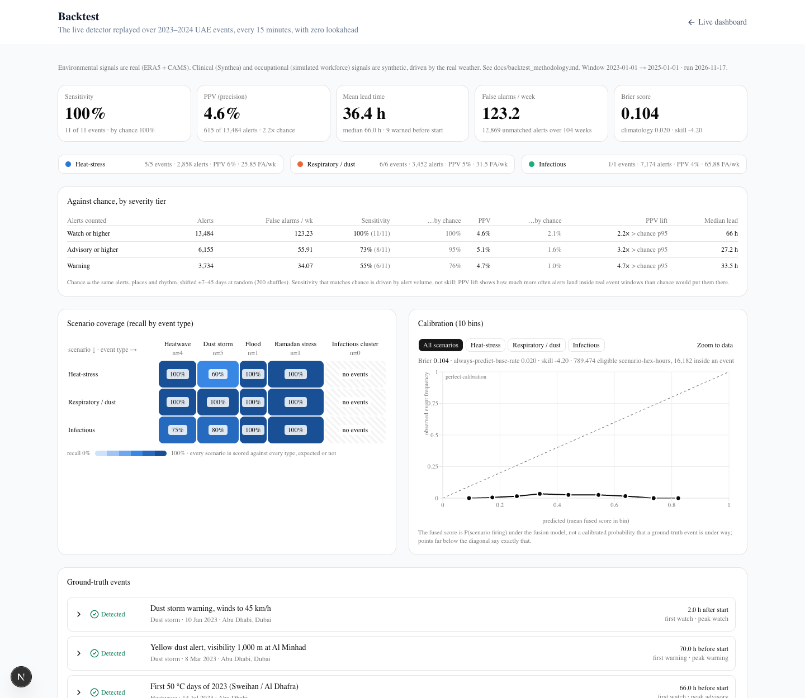
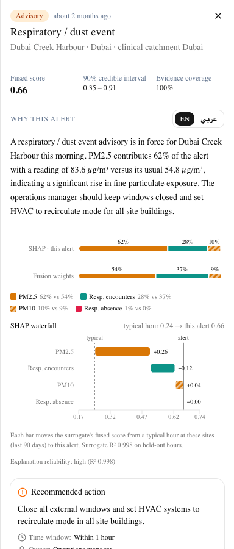
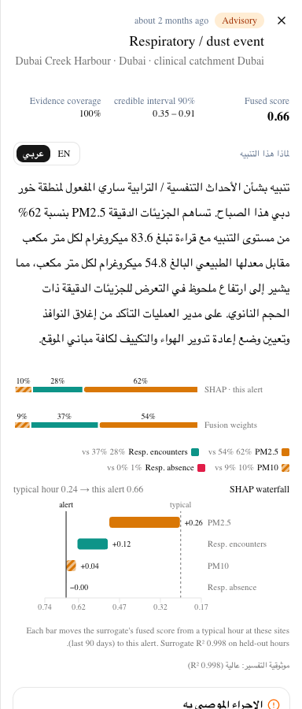
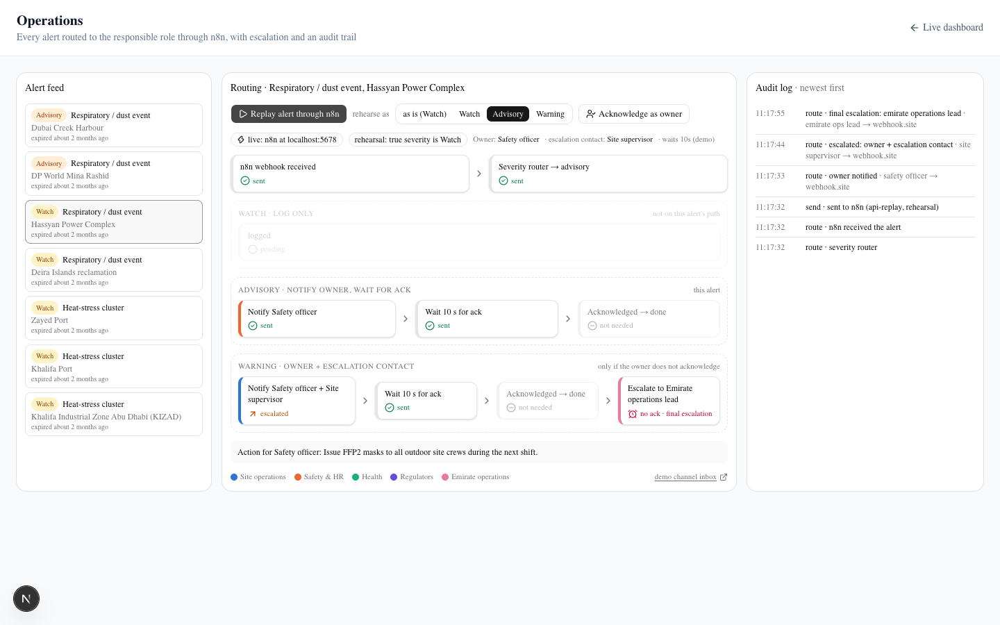
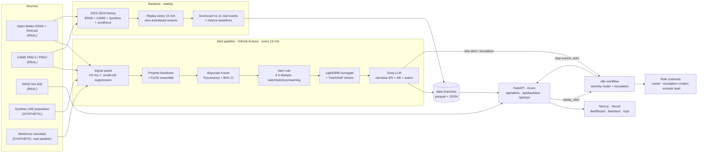

# Sentinel Grid

**Tri-signal early warning for population and workforce health in the UAE.** Sentinel Grid
fuses clinical, environmental and occupational signals into alerts that explain themselves
(SHAP + an LLM narrative in English and Arabic) and are routed to the role who must act
(n8n, with escalation and an audit trail). It is backtested against real 2023-2024 UAE events,
with honest numbers.

| | |
|---|---|
| Dashboard | https://sentinel-grid-health.vercel.app |
| Backtest | https://sentinel-grid-health.vercel.app/backtest |
| Operations (routing) | https://sentinel-grid-health.vercel.app/ops |
| API | https://sentinel-grid-api.azurewebsites.net |
| Swagger | https://sentinel-grid-api.azurewebsites.net/docs |
| 2-minute demo video | [Watch on Google Drive](https://drive.google.com/file/d/1Cm27mD-EoQFAY6ZNv8T0rtUJf-_Imxkw/view?usp=sharing) |
| Judges' one-pager | [docs/judge_quick_facts.md](docs/judge_quick_facts.md) |


<sub>The alert list above is a <b>labelled replay snapshot</b> (the real pipeline run as of
24 Sep 2026), because November is quiet and there were no live alerts when the screenshot was taken.</sub>

## Backtest scorecard: honest numbers

The live detector, replayed every 15 minutes over 2023-01-01 → 2024-12-31 with zero
lookahead, scored against 11 sourced UAE events: 4 heatwaves, 5 dust storms, the April 2024
floods and Ramadan 2024. **Chance** = the same alerts re-timed at random, 200 shuffles
("seasonal": ±7–45 days, so the season is kept). From
[docs/backtest_methodology.md](docs/backtest_methodology.md), verbatim:

| Alerts counted | Alerts | False alarms/wk | Sensitivity | …chance | PPV | …chance (p95) | PPV lift | Median lead |
|---|---|---|---|---|---|---|---|---|
| watch or higher | 13,484 | 123.2 | 100 % (11/11) | 99.7 % | 4.6 % | 2.1 % (2.5 %) | 2.2× | 66 h* |
| advisory or higher | 6,155 | 55.9 | 73 % (8/11) | 95.3 % | 5.1 % | 1.6 % (2.0 %) | 3.2× | 27 h |
| warning | 3,734 | 34.1 | 55 % (6/11) | 76.0 % | 4.7 % | 1.0 % (1.3 %) | 4.7× | 34 h |

Brier 0.104 vs 0.020 for always predicting the base rate (skill −4.2).

**Read it this way.**
* **The 100 % sensitivity is not a result.** The detector raises ~130 alerts a week, and
  randomly re-timed copies of the same alerts catch 99.7 % of the events too. At advisory and
  warning tiers the real stream does *worse* than chance on sensitivity.
* **The real signal is precision.** Alerts land inside real event windows 2.2× (watch), 3.2×
  (advisory) and 4.7× (warning) more often than chance, above the 95th percentile of 200
  shuffles at every tier. That is the one claim the backtest supports.
* \*Watch-tier lead time is an artefact: with near-continuous alerting, the first matching
  alert sits at the edge of the 72 h matching window.
* 123 false alarms a week is not operable. Thresholds were calibrated on autumn 2026 and need a
  full-year recalibration. The fused score is not a calibrated event probability (Brier skill
  −4.2).
* Heat and dust results are a **validation** (real weather in, real events out).
  Infectious results are a **plausibility check only** (no real outbreak record, synthetic
  clinical data).



## What is real, what is synthetic, what is simulated

| Part | Status | Source |
|---|---|---|
| Environmental signals | **REAL** | Open-Meteo (ERA5 archive + forecast), CAMS particulates via Open-Meteo, WAQI live stations |
| Occupational signals | **SYNTHETIC**, driven by real environment | seeded workforce simulator (`synth/workforce.py`), whose absence responds to the real heat and PM |
| Clinical signals | **SYNTHETIC** | Synthea UAE population (10,000 people). In the backtest a modest weather coupling adds heat/respiratory encounters on real hot/dusty days |
| Ground-truth events | **REAL** public records | NCM bulletins via news sources and WAM, each cited in `configs/ground_truth_events.yaml` |
| SHAP explanations | real computation | LightGBM surrogate of the fused score (R² 0.998 on held-out hours) + TreeSHAP |
| Narratives, Arabic, actions | real LLM output | Groq (`openai/gpt-oss-120b`, `allam-2-7b`), validated (numbers, schema, urgency) with template fallback |
| Alert routing | real n8n workflow | `ops/n8n/workflows/alert_routing.json`. Channels are public webhook.site demo inboxes (no real phone numbers or chat ids). If n8n is unreachable, the `/ops` page **simulates** the same plan and labels it |
| Replay snapshot | real pipeline, past time | `make demo-snapshot`: the pipeline as of a past hot day, shown as "Snapshot, not live" |

No patient-level data leaves the pipeline: clinical signals are aggregate catchment
counts, and cells under 5 records are suppressed. Prompts carry role titles and place names,
never people. See [docs/privacy.md](docs/privacy.md) and [docs/ETHICS.md](docs/ETHICS.md).

## Every alert explains itself, in English and Arabic

| English | العربية (the whole panel flips to RTL, charts mirror) |
|---|---|
|  |  |

Each alert carries SHAP drivers (what drove *this* alert vs the static fusion weights),
an LLM narrative grounded in those drivers, an Arabic translation with every number kept
verbatim, and a structured action (owner role, time window, escalation timer) validated by
pydantic.

## …and is routed to the role who must act



`watch` → logged only. `advisory` → notify the owner, wait 15 min, escalate if no ack.
`warning` → owner + their escalation contact (e.g. MoHRE inspector, DoH surveillance), then
the emirate operations lead. Every step reports back to `/api/ops/events` and appears in
`GET /api/ops/audit`. Setup: [docs/n8n_setup.md](docs/n8n_setup.md).

## Architecture



The same alert rule (`fusion/alerts.alert_groups`) runs live and in the backtest, and
the same routing payload (`ops/notify.py`) is used by the pipeline and the API.

## Run it

```bash
make test              # 125+ tests: fusion, SHAP, LLM narration (mocked), backtest lookahead, ops routing
make n8n-up n8n-import # n8n in Docker + the routing workflow
make demo-snapshot     # optional: real pipeline as of a past hot day (quiet season)
make demo-api SNAPSHOT=1
make demo-web          # http://localhost:3000
```

Pipelines: `python -m packages.pipelines.fusion.alerts` (alerts),
`python -m packages.pipelines.backtest.run --start 2023-01-01 --end 2024-12-31` (backtest,
~30 min on 4-8 cores).

## Docs

* [docs/backtest_methodology.md](docs/backtest_methodology.md): events, matching rules, metrics, results and every limitation
* [docs/judge_quick_facts.md](docs/judge_quick_facts.md): one-page cheat sheet
* [docs/demo_script.md](docs/demo_script.md): the 5-minute walkthrough
* [docs/n8n_setup.md](docs/n8n_setup.md): routing, tunnels, Azure settings
* [docs/methodology.md](docs/methodology.md), [docs/privacy.md](docs/privacy.md), [docs/ETHICS.md](docs/ETHICS.md)

Decision support only. Not a diagnostic tool.
